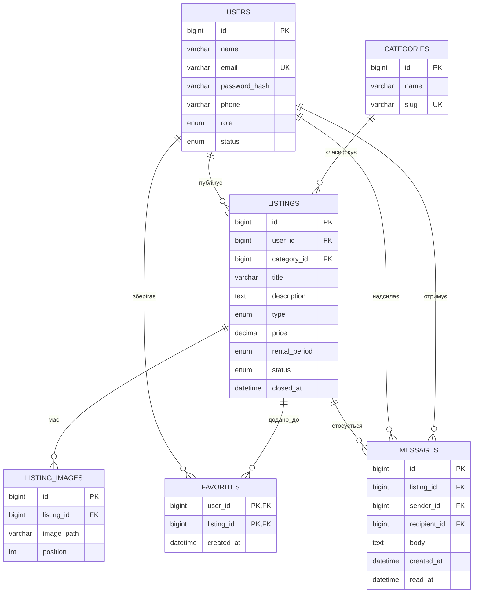

# Технічне завдання вебзастосунку «Дошка»

## 1. Опис предметної області

«Дошка» — вебзастосунок для розміщення оголошень про продаж, обмін або оренду речей. Відвідувачі переглядають каталог і знаходять потрібні пропозиції, зареєстровані користувачі керують власними оголошеннями та вибраним, а адміністратори модерують вміст і категорії.

Цільова аудиторія — мешканці міста, які хочуть продати, обміняти чи здати в оренду речі, та люди, які шукають такі пропозиції. Застосунок не обробляє оплату, доставку або бронювання за датами.

| Критерій наскрізного проєкту | Рішення |
| --- | --- |
| Збереження даних | MySQL |
| Реєстрація та ролі | Облікові записи користувачів і адміністраторів; гість працює без облікового запису |
| Пов’язані сутності | Оголошення, категорії, зображення, вибране та повідомлення |
| CRUD | Створення, перегляд, редагування й видалення оголошень; адміністрування категорій |

## 2. Ролі користувачів

| Роль | Мета | Доступні можливості |
| --- | --- | --- |
| Гість | Знайти потрібну річ | Переглядати, шукати й фільтрувати активні оголошення; переглядати публічні дані оголошення; зареєструватися або увійти |
| Користувач | Знайти річ або розмістити пропозицію | Усе доступне гостю, а також створювати й вести власні оголошення, керувати вибраним, надсилати повідомлення та редагувати профіль |
| Адміністратор | Підтримувати порядок на сайті | Переглядати й модерувати оголошення, керувати категоріями та обліковими записами |

Гість — це стан відвідувача без автентифікації, тому окремий запис із роллю `guest` у таблиці користувачів не створюється. Ролі `user` та `admin` призначаються обліковим записам.

## 3. Функційні вимоги

| № | Вимога | Роль | Пріоритет |
| ---: | --- | --- | --- |
| 1 | Гість може переглядати список активних оголошень. | Гість | Обов’язкова |
| 2 | Гість може шукати оголошення за частиною назви. | Гість | Обов’язкова |
| 3 | Гість може фільтрувати оголошення за категорією та типом: продаж, обмін або оренда. | Гість | Обов’язкова |
| 4 | Гість може відкрити сторінку оголошення з фотографіями, описом і публічною інформацією про автора; контакти автора доступні після входу. | Гість | Обов’язкова |
| 5 | Гість може зареєструватися та увійти. | Гість | Обов’язкова |
| 6 | Користувач може створити оголошення із назвою, описом, категорією, типом, ціною та фотографіями. | Користувач | Обов’язкова |
| 7 | Користувач може редагувати й видаляти лише власні оголошення. | Користувач | Обов’язкова |
| 8 | Користувач може додати оголошення до вибраного та переглянути список вибраного. | Користувач | Обов’язкова |
| 9 | Користувач може закрити своє оголошення: воно зникає з каталогу, але залишається в його списку. | Користувач | Бажана |
| 10 | Користувач може надіслати автору повідомлення через форму на сторінці оголошення. | Користувач | Бажана |
| 11 | Користувач може редагувати ім’я та номер телефону у своєму профілі. | Користувач | Бажана |
| 12 | Адміністратор може переглядати всі оголошення та приховувати або видаляти будь-яке з них. | Адміністратор | Обов’язкова |
| 13 | Адміністратор може створювати, редагувати й видаляти категорії. | Адміністратор | Обов’язкова |
| 14 | Адміністратор може заблокувати обліковий запис користувача. | Адміністратор | Бажана |

**Уточнення вимоги № 4.** У початковому описі зазначено, що гість бачить контакти автора, але сценарій гостя передбачає запит авторизації перед переглядом контактів. У цьому технічному завданні обрано другий варіант: гість бачить публічну інформацію, а приватні контакти — лише після входу.

### Нефункційні вимоги

| Категорія | Вимога |
| --- | --- |
| Продуктивність | Каталог із пагінацією має відображати результати пошуку та фільтрації не довше ніж за 2 секунди для 95% запитів за штатного навантаження. Для пошуку й зовнішніх ключів використовуються індекси бази даних. |
| Безпека | Паролі зберігаються лише у вигляді стійких хешів; запити до БД параметризуються; сервер перевіряє автентифікацію, роль і право власності перед зміною даних. Завантаження зображень перевіряється за типом і розміром. |
| Адаптивність і сумісність | Основні сторінки мають коректно працювати на ширині екрана від 360 px і в актуальних версіях Chrome, Firefox та Edge. |

## 4. Карта сайту та маршрути

```text
Головна /
├── Каталог /listings
│   └── Оголошення /listings/:id
├── Вхід /login                         [гість]
├── Реєстрація /register                [гість]
├── Створення оголошення /listings/new  [авторизований користувач]
├── Мої оголошення /my/listings         [авторизований користувач]
│   └── Редагування /my/listings/:id/edit [автор оголошення]
├── Вибране /favorites                  [авторизований користувач]
├── Повідомлення /messages              [авторизований користувач]
├── Профіль /profile                    [авторизований користувач]
└── Адміністрування /admin              [адміністратор]
    ├── Оголошення /admin/listings
    ├── Категорії /admin/categories
    └── Користувачі /admin/users
```

Захищеними є маршрути створення, редагування та керування власними оголошеннями, вибране, повідомлення, профіль і всі адміністративні сторінки. Перевірка прав виконується сервером, навіть якщо інтерфейс приховує недоступні розділи.

## 5. Користувацькі сценарії

### Сценарій гостя

1. Гість відкриває каталог оголошень.
2. Вибирає категорію «Інструменти» та тип «Оренда».
3. Відкриває потрібне оголошення й переглядає опис та фотографії.
4. Щоб побачити приватні контакти або зберегти оголошення, переходить до реєстрації та створює обліковий запис.
5. Після входу додає оголошення до вибраного.

### Сценарій зареєстрованого користувача

1. Користувач входить до облікового запису.
2. Відкриває форму створення оголошення, додає назву, опис, категорію, тип, ціну та фотографії.
3. Зберігає оголошення й перевіряє його у розділі «Мої оголошення».
4. Коли пропозиція більше не актуальна, закриває її; вона зникає з публічного каталогу, але залишається у списку користувача.

## 6. Структура даних

### Сутності та атрибути

| Сутність | Атрибути | Первинний ключ |
| --- | --- | --- |
| `users` | `id`, `name`, `email`, `password_hash`, `phone`, `role`, `status`, `created_at`, `updated_at` | `id` |
| `categories` | `id`, `name`, `slug`, `created_at`, `updated_at` | `id` |
| `listings` | `id`, `user_id`, `category_id`, `title`, `description`, `type`, `price`, `rental_period`, `status`, `created_at`, `updated_at`, `closed_at` | `id` |
| `listing_images` | `id`, `listing_id`, `image_path`, `position`, `created_at` | `id` |
| `favorites` | `user_id`, `listing_id`, `created_at` | складений: (`user_id`, `listing_id`) |
| `messages` | `id`, `listing_id`, `sender_id`, `recipient_id`, `body`, `created_at`, `read_at` | `id` |

`users.role` має значення `user` або `admin`, а `users.status` — `active` або `blocked`. `listings.type` має значення `sale`, `exchange` або `rent`. `listings.rental_period` має значення `day`, `week` або `month` і заповнюється лише для оренди. `listings.status` має значення `active`, `closed` або `hidden`: власник закриває власне оголошення, а адміністратор приховує його під час модерації. Ціна може бути порожньою для обміну.

### Зв’язки

- Один користувач має багато оголошень: `listings.user_id → users.id`.
- Одна категорія містить багато оголошень: `listings.category_id → categories.id`.
- Одне оголошення має багато зображень: `listing_images.listing_id → listings.id`.
- Користувачі мають багато оголошень у вибраному, а оголошення можуть бути у вибраному багатьох користувачів. Таблиця `favorites` реалізує зв’язок багато-до-багатьох і не допускає повтору пари користувач/оголошення.
- Одне оголошення може мати багато повідомлень. `messages.sender_id` і `messages.recipient_id` посилаються на `users.id`.

### ER-схема



## 7. Обґрунтування технологічного стеку

| Компонент | Технологія | Обґрунтування |
| --- | --- | --- |
| Клієнтський інтерфейс | React | Проєкт уже створений на React. Компонентний підхід підходить для повторного використання карток, форм і елементів фільтрації. |
| Інструмент розробки клієнта | Vite | Вже налаштований у репозиторії; забезпечує локальний сервер розробки та збирання клієнтського застосунку. |
| Серверна частина | PHP 8 | Підходить для реалізації REST API та інтегрується з наявним середовищем XAMPP. Сервер зможе централізовано перевіряти доступ і валідувати дані. |
| База даних | MySQL | Реляційна модель підтримує чіткі зв’язки між користувачами, оголошеннями, категоріями, фото, вибраним і повідомленнями та забезпечує обмеження цілісності. |
| Обмін даними | JSON через REST API | Дає змогу клієнту React працювати із сервером PHP через окремі ресурси й HTTP-запити. |
| Стилі | CSS | Достатньо для адаптивного інтерфейсу без додаткової бібліотеки стилів. |

## 8. Межі проєкту

До першої версії не входять онлайн-оплата, доставка, бронювання за датами, рейтинги продавців і чат у реальному часі. Обмін повідомленнями реалізується як надсилання та перегляд збережених повідомлень.

## 9. Поточний стан репозиторію

У репозиторії налаштовано початковий клієнтський каркас React/Vite. Цей документ фіксує цільову архітектуру наскрізного проєкту; API на PHP та база даних MySQL є наступними етапами реалізації.
